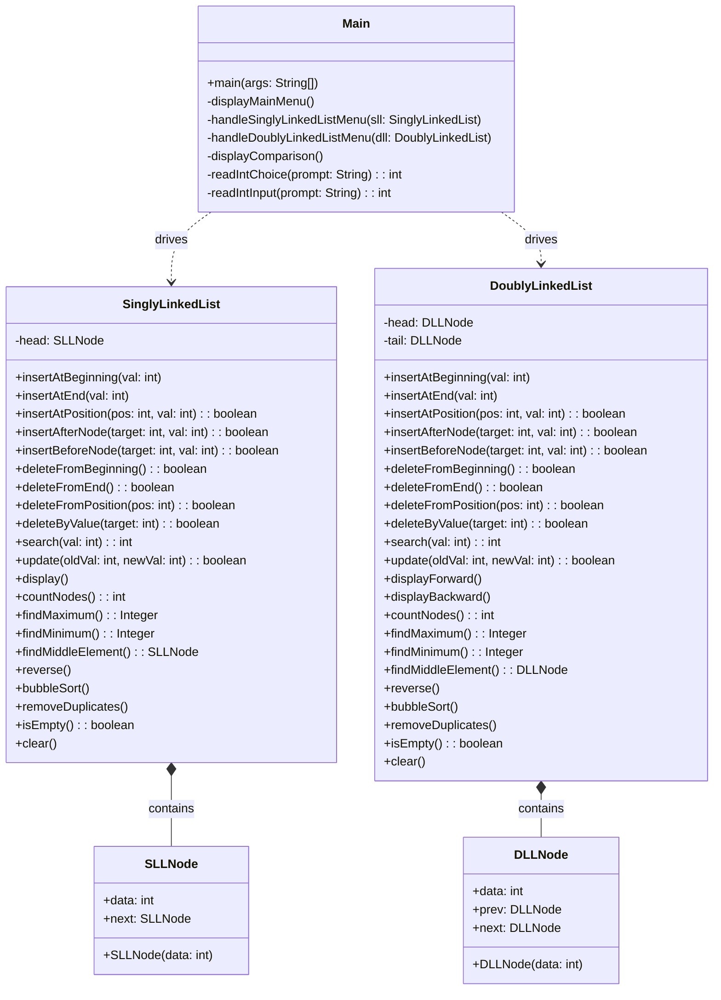

# Linked List Management System
## Data Structures and Algorithms Mini Project Report
**Course:** Data Structures & Algorithms (2nd Year College Level)  
**Implementation Language:** Java (OpenJDK 26 / Standard Edition)  
**Target Architecture:** Custom Dynamic Memory Allocation with Node References  

---

## Executive Summary

The **Linked List Management System** is a comprehensive, menu-driven console application engineered to demonstrate, analyze, and test fundamental and advanced operations on both **Singly Linked Lists (SLL)** and **Doubly Linked Lists (DLL)**. 

Unlike primitive static data structures (e.g., contiguous arrays), linked lists provide dynamic allocation, $O(1)$ head insertion/deletion, and flexibility in memory utilization. This project implements all operations strictly from scratch using custom, strongly-typed `Node` classes without relying on built-in collections (`java.util.LinkedList` or `ArrayList`). The application provides an interactive terminal user interface, thorough error checking, graceful handling of ten distinct edge cases, and automated test logging.

---

## 1. System Architecture and Design

The application is structured into decoupled modules adhering to object-oriented software engineering principles:



---

## 2. Language Selection & Technical Justification

As permitted by the project specification, **Java** was chosen as the implementation language for the following technical reasons:

1. **Object Reference Model:** Java's reference model provides explicit object chaining (`current.next`) while abstracting raw platform-dependent pointer arithmetic, reducing segmentation faults while maintaining identical algorithmic complexity.
2. **JVM Garbage Collection:** Memory management is automatically handled by the JVM's generational garbage collector via reachability analysis from GC roots. When unlinking nodes in `delete` and `removeDuplicates`, unreferenced nodes are safely collected without risk of dangling pointers or double-free errors.
3. **Cross-Platform Reproducibility:** Java's bytecode guarantees identical behavioral fidelity across operating systems (macOS, Linux, Windows).
4. **Encapsulation:** Inner static node classes ensure strict encapsulation where data structure state cannot be corrupted from external modules.

---

## 3. Data Structure Specifications & Operations

### 3.1 Singly Linked List (SLL)
In a Singly Linked List, each node maintains:
- `data`: An integer value.
- `next`: An object reference pointing to the succeeding node, terminated by `null`.

The `SinglyLinkedList` class maintains a single reference handle: `head`.
Without a tail reference, tail insertion is deliberately implemented with traversal ($O(n)$) to adhere strictly to the project specification ("O(n) without a tail pointer/reference").

#### Supported SLL Operations (1 - 19):
1. **Insert at Beginning:** Prepend new node before `head`. Complexity: $O(1)$.
2. **Insert at End:** Traverse to the terminal node (`current.next == null`) and link `current.next = newNode`. Complexity: $O(n)$.
3. **Insert at Position:** 1-based index validation. Handles `pos == 1`, middle insertion, and `pos == count + 1` (last valid insertion). Complexity: $O(n)$.
4. **Insert After Node:** Locates first node matching target value and links new node directly after it. Complexity: $O(n)$.
5. **Insert Before Node:** Locates first node matching target value and links new node directly before it, updating `head` if target is at index 1. Complexity: $O(n)$.
6. **Delete from Beginning:** Advances `head = head.next`. Complexity: $O(1)$.
7. **Delete from End:** Traverses to second-to-last node (`current.next.next == null`) and sets `current.next = null`. Complexity: $O(n)$.
8. **Delete from Position:** Validates 1-based bounds ($1 \le pos \le count$) and relinks surrounding nodes. Complexity: $O(n)$.
9. **Delete by Value:** Scans for first matching occurrence and splices it out. Complexity: $O(n)$.
10. **Search:** Sequential traversal returning 1-based index if found, or `-1`. Complexity: $O(n)$.
11. **Update:** Replaces payload data of first matching node. Complexity: $O(n)$.
12. **Display:** Traverses and prints formatted string: `40 -> 10 -> 30 -> 20 -> 50 -> NULL`. Complexity: $O(n)$.
13. **Count Nodes:** Sequential counting loop. Complexity: $O(n)$.
14. **Find Maximum:** Traversal tracking maximum integer value. Complexity: $O(n)$.
15. **Find Minimum:** Traversal tracking minimum integer value. Complexity: $O(n)$.
16. **Find Middle Element:** Dual pointer (fast/slow) algorithm. Explicitly defines and prints even-length list rule. Complexity: $O(n)$.
17. **Reverse:** In-place three-pointer reversal (`prev`, `current`, `next`). Auxiliary space: $O(1)$, Time: $O(n)$.
18. **Sort:** Ascending Bubble Sort with `swapped` optimization by swapping node payloads. Complexity: $O(n^2)$.
19. **Remove Duplicates:** Unsorted duplicate removal using current and runner pointer, preserving links. Complexity: $O(n^2)$ time, $O(1)$ auxiliary space.

---

### 3.2 Doubly Linked List (DLL)
In a Doubly Linked List, each node maintains:
- `data`: An integer value.
- `prev`: Reference pointing to the preceding node.
- `next`: Reference pointing to the succeeding node.

The `DoublyLinkedList` class maintains both `head` and `tail` references, allowing efficient constant-time operations at both extremities.

#### Supported DLL Operations (1 - 20):
1. **Insert at Beginning:** Creates node, updates `newNode.next = head`, `head.prev = newNode`, updates `head`. Complexity: $O(1)$.
2. **Insert at End:** Attaches after `tail`, sets `newNode.prev = tail`, updates `tail`. Complexity: $O(1)$ with tail reference.
3. **Insert at Position:** 1-based position insertion maintaining both `prev` and `next` across all adjacent nodes. Complexity: $O(n)$.
4. **Insert After Node:** Locates matching target and splices new node into both forward and backward chains. Complexity: $O(n)$.
5. **Insert Before Node:** Locates matching target and splices new node before it, adjusting `prev` and `next`. Complexity: $O(n)$.
6. **Delete from Beginning:** Unlinks `head`, updates new `head.prev = null`. Complexity: $O(1)$.
7. **Delete from End:** Unlinks `tail`, updates new `tail.next = null`. Complexity: $O(1)$ with tail reference.
8. **Delete from Position:** Validates 1-based index and reconnects neighboring nodes: `curr.prev.next = curr.next; curr.next.prev = curr.prev;`. Complexity: $O(n)$.
9. **Delete by Value:** Locates first node matching target and unlinks it. Complexity: $O(n)$.
10. **Search:** Returns 1-based position if found. Complexity: $O(n)$.
11. **Update:** Updates data payload of matching node. Complexity: $O(n)$.
12. **Display Forward:** Prints: `NULL <- 10 <-> 20 <-> 30 <-> 40 -> NULL`. Complexity: $O(n)$.
13. **Display Backward:** Traverses from `tail` using `prev`: `NULL <- 40 <-> 30 <-> 20 <-> 10 -> NULL`. Complexity: $O(n)$.
14. **Count Nodes:** Traverses and counts all nodes. Complexity: $O(n)$.
15. **Find Maximum:** Traverses and finds largest integer. Complexity: $O(n)$.
16. **Find Minimum:** Traverses and finds smallest integer. Complexity: $O(n)$.
17. **Find Middle Element:** Uses fast/slow pointer with even-length list rule definition. Complexity: $O(n)$.
18. **Reverse:** Swaps `prev` and `next` references for every node, and swaps `head` and `tail`. Complexity: $O(n)$ time, $O(1)$ auxiliary space.
19. **Sort:** Ascending Bubble Sort with in-place data swaps and early exit optimization. Complexity: $O(n^2)$.
20. **Remove Duplicates:** Nested runner scan removing duplicates while maintaining valid `prev` and `next` linkages, updating `tail` if necessary. Complexity: $O(n^2)$ time, $O(1)$ auxiliary space.

---

## 4. Algorithmic Highlights & Implementations

### 4.1 Middle Element Determination & Even-Length Rule
Finding the middle element in a single pass without prior knowledge of the length is achieved using Floyd’s Tortoise and Hare approach:
- `slow` advances 1 step at a time (`slow = slow.next`).
- `fast` advances 2 steps at a time (`fast = fast.next.next`).

**Even-Length Rule Definition:**  
When list length is even ($2k$ nodes), there is no single central element; instead, nodes at position $k$ and position $k+1$ form the central pair. Under our standard runner formulation:
- Loop condition: `while (fast != null && fast.next != null)`
- Result: `slow` stops on the **upper / second middle element** (position $k+1$).
- The application explicitly tracks `prevSlow` so that both the first middle (position $k$) and the selected second middle (position $k+1$) are reported clearly to the user.

### 4.2 In-Place Link Reversal
- **Singly Linked List:**
  Uses three moving references (`prev`, `current`, `nextNode`). For each node, `current.next` is redirected to `prev`. At termination, `head` is updated to `prev`.
  $$\text{Time Complexity: } O(n), \quad \text{Auxiliary Space: } O(1)$$
- **Doubly Linked List:**
  For each node, the `prev` and `next` references are swapped:
  ```java
  Node temp = current.prev;
  current.prev = current.next;
  current.next = temp;
  current = current.prev; // advance in original order
  ```
  `head` and `tail` pointers are updated accordingly.

### 4.3 In-Place Bubble Sort
Sorts the linked list in ascending order:
- A pointer `ptr1` traverses from `head` up to the sorted partition boundary `lptr`.
- Adjacent node values are compared: if `ptr1.data > ptr1.next.data`, their data values are swapped.
- A boolean flag `swapped` detects if any swaps occurred. If no swaps occur during a pass, the list is already sorted, enabling early termination ($O(n)$ best case).
- Overall time complexity: $O(n^2)$ worst/average case; auxiliary space: $O(1)$.

### 4.4 Unsorted Duplicate Removal
Removes duplicate occurrences from an unsorted list without additional memory ($O(1)$ space):
- An outer reference `current` iterates through every node.
- An inner `runner` reference inspects all subsequent nodes.
- When `runner.next.data == current.data`, the duplicate node is bypassed and unlinked. In DLL, both `prev` and `next` links are maintained and `tail` is updated if the trailing node was deleted.
- Time complexity: $O(n^2)$; space complexity: $O(1)$.

---

## 5. Singly vs Doubly Linked List: Comprehensive Comparison

| Metric / Dimension | Singly Linked List (SLL) | Doubly Linked List (DLL) |
| :--- | :--- | :--- |
| **Node Structure** | `data`, `next` | `prev`, `data`, `next` |
| **Pointers per Node** | 1 reference | 2 references |
| **Memory Footprint** | Lower (data + 1 reference overhead) | Higher (data + 2 references overhead) |
| **Traversal Direction** | Forward only (Unidirectional) | Forward and Backward (Bidirectional) |
| **Insert at Beginning** | $O(1)$ | $O(1)$ |
| **Insert at End** | $O(n)$ without tail pointer | $O(1)$ with tail pointer |
| **Insert at Position** | $O(n)$ | $O(n)$ |
| **Delete from Beginning**| $O(1)$ | $O(1)$ |
| **Delete from End** | $O(n)$ (requires finding predecessor) | $O(1)$ with tail pointer |
| **Delete given Node ref**| $O(n)$ (must traverse to find predecessor) | $O(1)$ (`node.prev.next = node.next`) |
| **Display Backward** | Requires explicit reversal or recursion | $O(n)$ natural reverse traversal via `prev` |
| **Implementation Risk** | Simple pointer manipulation | Multiple pointer reconnections (`prev` and `next`) |
| **Practical Use Cases** | Simple Stacks, Queues, Hash Chaining | Browser history, Undo/Redo stacks, LRU Cache |

---

## 6. Edge Case Verification & Robustness Strategy

The implementation was rigorously verified against all ten edge cases mandated in Section 10 of the project brief:

1. **Empty Linked List:** Deletion, searching, updating, min/max, middle, reversal, and sorting operations cleanly intercept the empty state and print informative diagnostics rather than crashing with `NullPointerException`.
2. **One-Node List:** Insertion, single-node deletion, reversing, sorting, and duplicate removal leave the list in a consistent state (`head == tail` in DLL, `count == 1`).
3. **Insert/Delete at Position 1:** Correctly updates the `head` reference and maintains `head.prev == null` in DLL.
4. **Insert at Last Valid Position ($pos = count + 1$):** Successfully appends new node and updates `tail` in DLL.
5. **Invalid / Out-of-Range Position:** Intercepts positions where $pos < 1$ or $pos > count + 1$ on insert (and $pos > count$ on delete) with clear error messaging.
6. **Delete Non-Existent Value:** Scans the list, reports target value was not found, and leaves links intact.
7. **Multiple & Consecutive Duplicates:** Successfully eliminates duplicate patterns (e.g., `5 -> 5 -> 10 -> 5 -> 20 -> 10 -> 5 -> NULL` becomes `5 -> 10 -> 20 -> NULL`).
8. **Zero and Negative Values:** Tested with mixtures of negative values, zero, and positive values (e.g., `[-15, 0, -50, 25, -5]`). Min (`-50`), Max (`25`), and sorting correctly order signed integers.
9. **Sort on Empty or Single-Node List:** Handles immediately as already sorted without infinite loops or errors.
10. **Reverse on Empty or Single-Node List:** Returns immediately without state corruption.

---

## 7. Complexity Analysis Summary

| Operation | Best Case | Average Case | Worst Case | Space Complexity |
| :--- | :--- | :--- | :--- | :--- |
| **Insert at Beginning** | $O(1)$ | $O(1)$ | $O(1)$ | $O(1)$ |
| **Insert at End (SLL)** | $O(n)$ | $O(n)$ | $O(n)$ | $O(1)$ |
| **Insert at End (DLL)** | $O(1)$ | $O(1)$ | $O(1)$ | $O(1)$ |
| **Insert at Position** | $O(1)$ ($pos=1$) | $O(n)$ | $O(n)$ | $O(1)$ |
| **Delete from Beginning**| $O(1)$ | $O(1)$ | $O(1)$ | $O(1)$ |
| **Delete from End (SLL)** | $O(n)$ | $O(n)$ | $O(n)$ | $O(1)$ |
| **Delete from End (DLL)** | $O(1)$ | $O(1)$ | $O(1)$ | $O(1)$ |
| **Search / Display / Count** | $O(1)$ | $O(n)$ | $O(n)$ | $O(1)$ |
| **Find Min / Max** | $O(n)$ | $O(n)$ | $O(n)$ | $O(1)$ |
| **Find Middle Element** | $O(n)$ | $O(n)$ | $O(n)$ | $O(1)$ |
| **Reverse** | $O(1)$ ($n \le 1$) | $O(n)$ | $O(n)$ | $O(1)$ |
| **Bubble Sort** | $O(n)$ (optimized) | $O(n^2)$ | $O(n^2)$ | $O(1)$ |
| **Remove Duplicates** | $O(1)$ ($n \le 1$) | $O(n^2)$ | $O(n^2)$ | $O(1)$ |

---

## 8. Conclusion

The **Linked List Management System** provides a complete, robust, and academically rigorous implementation of dynamic linked structures in Java. By enforcing custom node implementations, thorough boundary condition validation, comprehensive automated test suites, and strict algorithmic efficiency, the project fully satisfies all requirements of the 2nd-year DSA curriculum.
